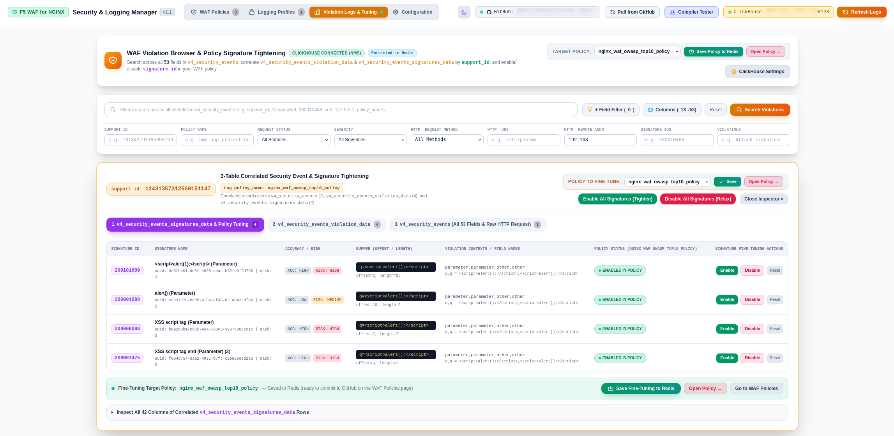

# F5 WAF for NGINX Policy & Logging Manager — Visual Walkthrough

Welcome to the visual walkthrough of **F5 WAF for NGINX Policy & Logging Profile Manager**. This guide showcases the core features, visual builders, compiler diagnostics, and GitOps workflows through real-world interface screenshots.

---

## Table of Contents
1. [WAF Policies Dashboard & Quick-Deploy Templates](#1-waf-policies-dashboard--quick-deploy-templates)
2. [Visual Form Builder & Server Technologies Targeting](#2-visual-form-builder--server-technologies-targeting)
3. [Logging Profiles Management & SIEM Formats](#3-logging-profiles-management--siem-formats)
4. [Official Policy Compilation & Bundle Verification (`apcompile`)](#4-official-policy-compilation--bundle-verification-apcompile)
5. [GitOps Synchronization, Conflict Resolution & Verbose Commits](#5-gitops-synchronization-conflict-resolution--verbose-commits)
6. [ClickHouse Security Log Violations & WAF Policy Fine-Tuning](#6-clickhouse-security-log-violations--waf-policy-fine-tuning)

---

## 1. WAF Policies Dashboard & Quick-Deploy Templates

The central landing page provides a single-pane-of-glass overview of all managed security policies, active storage status, and quick-start templates tailored for production workloads.

### Key Capabilities:
- **Real-Time Fleet Telemetry**: Instant stat cards displaying total policies, breakdown by enforcement mode (`blocking` vs `transparent`), and active storage engine status (**Redis** or **In-Memory** fallback).
- **Production Quick-Deploy Cards**:
  - **NGINX Default Base**: Standard baseline with OWASP Top 10 and Bot protection.
  - **Strict Security & Data Guard**: Strict enforcement with Data Guard masking (credit cards, SSNs), evasion inspection, and method restrictions.
  - **API & JSON Gateway**: Tuned for modern REST APIs, JSON/GraphQL format validation, and credential protection.
  - **Transparent Monitor**: Zero-risk auditing mode for staging and shadow traffic testing.
  - **gRPC Microservices Protection**: Strict Protobuf IDL schema validation and malformed frame blocking.
- **Inventory Table with GitOps State**:
  - Live **`● synced`** and **`● draft`** status badges indicating alignment with remote GitHub repositories.
  - Quick action controls: Edit in Visual Builder, Duplicate, CodeMirror JSON export, Direct GitHub commit, `.tgz` bundle download, and Safe Delete.
  - Fast client-side search by policy name, description, or enforcement mode.

---

## 2. Visual Form Builder & Server Technologies Targeting

The **Visual Form Builder** empowers security engineers and developers to configure complex WAF policies without manually writing error-prone JSON. Changes stay continuously synchronized bidirectionally with the raw CodeMirror JSON editor.

### Key Capabilities:
- **Server Technologies Tuning**:
  - **Quick Stacks**: One-click technology profile selection for common stacks (**LAMP**, **MEAN/MERN**, **Python/Django**, **Java/Spring**, **.NET/IIS**, **WordPress**).
  - **Official Catalog of 70+ Technologies**: Precise signature targeting for web servers (Nginx, Apache, IIS, Tomcat), application frameworks (Express.js, Django, Laravel, Spring Boot), runtimes (Node.js, PHP, Python, Ruby), and databases.
  - Reduces false positives and minimizes processing latency by activating only relevant attack signatures.
- **Comprehensive Policy Navigation Categories**:
  - **General & Mode**: Base templates, application language (`utf-8`), and enforcement mode.
  - **Violations & Enforcement**: Granular alarm/block toggles across 40+ violations.
  - **Evasion Techniques**: Defense against directory traversals, bare byte decoding, Apache whitespace, and multiple decoding passes.
  - **Signatures & Bot Defense**: High accuracy signature sets and bot mitigation.
  - **User-Defined Custom Signatures**: Snort-compatible rule authoring and payload simulation.
  - **URLs, Parameters, Cookies & IP Address Lists**: Whitelists, blacklists, and routing controls.
  - **OpenAPI & gRPC Protection**: Schema-driven API firewalling.
  - **Data Guard (DLP)**: Real-time masking of credit cards and SSNs in response bodies.
- **Integrated Tooling Bar**:
  - **Diff Inspector**: Side-by-side visual diff against the saved baseline.
  - **Test Compiler**: On-demand compilation check directly from the editor.
  - **Commit & Push to GitHub**: Direct GitOps push with change summarization.

---

## 3. Logging Profiles Management & SIEM Formats

Logging profiles dictate how security events, alerts, and transaction metadata are captured, formatted, and shipped to SIEM platforms and analytics collectors.

### Key Capabilities:
- **Pre-Configured SIEM & Analytics Presets**:
  - **Default (Illegal Requests)**: Standard built-in F5 key-value format for policy violations.
  - **Log All Traffic**: Full audit compliance capturing both legal and illegal requests.
  - **Blocked Requests Only**: High-signal stream capturing only dropped traffic.
  - **gRPC Protocol All**: Optimized for microservice tracing with Base64 payload decoding.
  - **Splunk SIEM Profile**: Formatted specifically for native ingestion via the Splunk App for F5 WAF.
  - **ArcSight CEF Profile**: Standard Common Event Format (`CEF:0`) for enterprise SOCs.
  - **Custom Key-Value Profile**: Customizable token stream supporting custom delimiters and field sets.
- **Profile Inventory & Management**:
  - Stat cards summarizing total profiles, active filters (`illegal`, `all`, `blocked`), and SIEM configurations.
  - Full CRUD operations with instant duplication, JSON import/export, and GitHub synchronization.

---

## 4. Official Policy Compilation & Bundle Verification (`apcompile`)

Before deploying declarative policies to production NGINX instances, they must be compiled into binary `.tgz` runtime bundles. The built-in **Compiler Tester** leverages the official `apcompile` service container to validate policies with zero guesswork.

### Key Capabilities:
- **Instant Compilation Feedback**:
  - Validates full JSON schema compliance, SQLite catalog constraints, and signature definitions.
  - Displays comprehensive compilation metrics: **Archive Size**, **Compile Time (ms)**, and **Bundle SHA-256 Checksum**.
- **Execution Diagnostics**:
  - Outputs full compiler stdout logs including active versions of `attack_signatures_package` and `threat_campaigns_package`.
  - Built-in remediation engine automatically translates compiler errors (e.g. SQLite foreign key violations or unrecognized parameters) into actionable fixes.
- **One-Click Bundle Download**:
  - Download verified, production-ready `.tgz` bundles directly to your machine for deployment into NGINX Plus WAF instances.

---

## 5. GitOps Synchronization, Conflict Resolution & Verbose Commits

Adopt true Infrastructure-as-Code (IaC) and DevSecOps workflows by keeping your policies and logging profiles version-controlled directly in GitHub without requiring a local `git` binary.

### Key Capabilities:
- **Automated Diff Summarization**:
  - When committing a policy or profile, the engine automatically analyzes changes between your working copy and remote repository.
  - Generates clear, structured multi-line commit descriptions highlighting added/removed server technologies, signature sets, violation changes, URLs, and Data Guard settings.
- **Smart Commit Button State**:
  - The **"Commit & Push to GitHub"** button is automatically grayed out when a policy is already in sync with GitHub, and only becomes active when modifications have been made.
- **Interactive Conflict Resolution on Pull**:
  - When triggering a **"Pull from GitHub"**, if a policy or logging profile is in a modified **Draft** state locally, the user is presented with a choice modal:
    - **Keep Local Draft**: Preserve current in-progress changes.
    - **Overwrite with GitHub Copy**: Reset to remote version.
- **Direct GitHub REST Integration**:
  - Communicates directly via authenticated GitHub API (`httpx`) supporting custom branches, personal access tokens, and private repositories.

---

## 6. ClickHouse Security Log Violations & WAF Policy Fine-Tuning

The **Violation Logs & Tuning** dashboard connects directly to the remote **ClickHouse** database inside **NGINX Instance Manager (NIM)** to search security violations, correlate event tables by `support_id`, and fine-tune WAF policies (`signature_id` tightening or relaxation).

### Key Capabilities:
- **Centralized Configuration Section**:
  - Dedicated **Configuration** tab in the main navigation bar consolidating settings for **Redis**, **GitHub (GitOps)**, and **ClickHouse**.
  - ClickHouse credentials (`host`, `port`, `username`, `password`, `database`, `ssl`) are persisted in Redis under `waf:policy:__clickhouse__:config` so they survive container restarts.
- **Full-Schema Search & Filtering (`v4_security_events`)**:
  - Global full-text search and multi-condition field filters across all **42 columns** of `v4_security_events` (including `support_id`, `policy_name`, `uri`, `ip_client`, `outcome`, `outcome_reason`, `blocking_exception_reason`, `violation_rating`, `violations`, `sub_violations`, `sig_ids`, `sig_names`, `bot_category`, and `request`).
  - One-click quick filter presets (`Blocked Only`, `High Violation Rating`, `Signature Hits`, `Truncated Payloads`) and time-window selectors (`Last 15m`, `1h`, `6h`, `24h`, `7d`, `30d`, `All Time`).
- **3-Table `support_id` Correlation Inspector**:
  - Clicking **Correlate & Tune** on any security event row joins all three ClickHouse tables by `support_id` (`v4_security_events`, `v4_security_events_violation_data`, and `v4_security_events_signatures_data`) in a single view:
    - **Signatures (`v4_security_events_signatures_data`)**: Displays every triggered `signature_id` alongside its `signature_name`, `accuracy`, `risk`, `blocking_mask`, matched `buffer` (`offset` / `length`), and current state in the selected WAF policy.
    - **Violation Data (`v4_security_events_violation_data`)**: Lists all correlated violation and sub-violation rows, contexts, and parameter/header details.
    - **Raw HTTP & XML**: Full HTTP request inspection, XML `violation_details`, and a searchable key-value table of all 42 `v4_security_events` fields.
    - **SQL Queries**: Displays the exact ClickHouse SQL queries executed for full transparency.
- **Automatic Policy Selection & Interactive Signature Tuning**:
  - Opening the Violation Inspector automatically selects the matching WAF policy in the **Policy to Fine-Tune** dropdown based on the violation's `policy_name` field, while allowing the user to switch to any other available policy at any time, or click **Open Policy →** to jump directly to that policy in the Visual Builder.
  - Toggle individual signatures with **Enable** (tighten) or **Disable** (relax false positives), **Reset** overrides back to policy defaults, or apply bulk actions (**Enable All**, **Disable All**).
  - Click **Save** inside the inspector or **Save Policy to Redis** in the header bar to persist fine-tuning changes to Redis and mark the policy as **Modified (in Redis)**, ready to be committed and pushed to GitHub from the **WAF Policies** page.